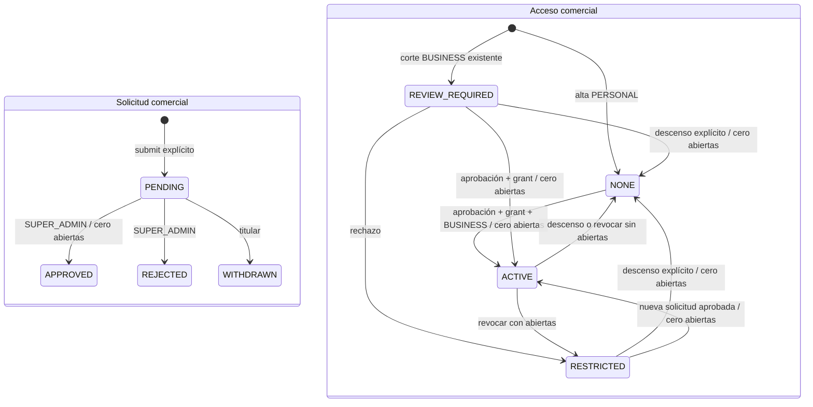

# Aprobación manual BUSINESS — diseño Backend para revisión

> Actualización 2026-10-12: backend implementado localmente con autorización posterior. El [informe de implementación](BUSINESS-APPROVAL-IMPLEMENTATION.md) y OpenAPI describen el resultado; la regresión E2E final se completó con69/69 en bases aisladas por archivo; el aborto anterior conserva causa nativa no concluyente. Las referencias a etapa documental siguientes se conservan como historia del diseño. Sin despliegue.

2026-10-12. **Contrato candidato, NO implementado. Requiere autorización nueva.** Referencia real: QA `ce45dff`, 45 migraciones; sin diferencias de producto en src/prisma/scripts/test respecto de ese commit. Se conservan cambios documentales previos y `nul`. Propuesta canónica: [BUSINESS-APPROVAL-PROPOSAL](BUSINESS-APPROVAL-PROPOSAL.md). Este documento concreta su diseño; no es OpenAPI ni anuncia rutas disponibles.

## 1. Decisiones y evidencia

Ya aprobadas: solicitud y aprobación manual, sólo SUPER_ADMIN, activación con cero solicitudes abiertas, revisión obligatoria de BUSINESS existentes preservando servicios comprometidos. LEGACY_MIGRATION activo automático queda descartado.

CustomerAccount identifica al cliente directo; BusinessApplication registra su solicitud; BusinessAccessGrant acredita autorización comercial. Ninguno acredita pago ni concede IntegrationClient, proveedor o roles operativos. businessName y BUSINESS no bastarán como autorización. User.active/CustomerAccount.active conservan acceso general, no se convierten en interruptores comerciales.

Sin pasarela, planes ficticios, suscripciones, precio, periodicidad ni cobro. Cuota futura, envío, mercancía y créditos Mandaria son conceptos separados. No cambiar B2B, cinco intentos, tarifas, GPS, hitos, custodia, ledger o refunds. Decisiones comerciales consultables por API; no añadir correo automático de decisiones en esta etapa.

Fuentes verificadas por lectura en esta tarea:

| Fuente | Evidencia y consecuencia |
|---|---|
| `src/customers/customers.dto.ts` | RegisterCustomerDto y CustomerProfileDto aceptan BUSINESS; ChangeCustomerTypeDto también |
| `src/customers/customers.controller.ts` | register/resend comparten register; confirm, attach y profile/type son superficies distintas que deben cerrarse |
| `src/customers/customers.service.ts`: challenge/confirm | REGISTER guarda perfil JSON y confirm crea cuenta con su tipo; cambiar sólo el DTO no cierra tokens anteriores |
| Mismo servicio: attach/changeType/update | attach crea con DTO; changeType permite ascenso con lock y cero abiertas; update sólo nombres pero incrementa revisión |
| Mismo servicio: account/capabilities | account controla actividad/verificación, capabilities usa type; no insertar gate comercial global en account |
| `src/auth/auth.guards.ts` | AccessGuard comprueba sesión/actividad; RolesGuard rol actual. JWT humano no equivale a autorización BUSINESS |
| `src/customers/demand-owner.ts` | lockCustomer usa FOR UPDATE; CUSTOMER/INTEGRATION son owners excluyentes |
| `src/customers/shipping-terms.ts` | PERSONAL sólo REQUESTER; policyRevision=CustomerAccount.revision; termsHash congela términos |
| `src/delivery-prequotes/prequotes.service.ts` | replay precede nueva admisión; routing fuera de transacción; se necesitan checks antes de nuevo trabajo y al publicar |
| `src/delivery-prequotes/prequote-persistence.service.ts` | reserve/owned usan customerAttempt y lock de cuenta; publish permite revalidar bajo ese lock |
| `src/delivery-prequotes/prequote-conversion.service.ts` | lock cuenta, cupo Personal, MPQ/zona, TTL y termsHash; SHIPPING_POLICY_CHANGED; MDR/MQ/lifecycle atómicos |
| `src/delivery-quotes/authorized-acceptance.service.ts`: acceptDirect | valida contra DeliveryShippingTerms congelados de MDR, no contra términos recalculados del perfil; conservar esa frontera |
| `src/idempotency/idempotency.service.ts`, `src/idempotency/human-attempt.ts`, `src/customers/command-attempts.service.ts` | hash, fence y recuperación logística existentes; reutilizar primitivas, sin convertir decisiones comerciales en operaciones B2B |
| `prisma/migrations/20261006000200_direct_demand_and_shipping/migration.sql` | direct_lifecycle_validate/close, direct_type_guard y shipping_terms_check: cupo/tipo, cierre durable y términos inmutables |
| `prisma/schema.prisma` | CustomerAccount/CustomerChallenge/DirectRequestLifecycle existen; BusinessApplication/Grant aún no |

Abierta significa **DirectRequestLifecycle.closedAt IS NULL**, incluso MDR convertida sin aceptar. Vencimiento visual no equivale a cierre persistido. GET capabilities no cierra recursos para permitir aprobar. Se conservan reglas y autoridades de cierre existentes.

## 2. Modelo mínimo propuesto

- CustomerAccount conserva type/revision y agrega businessAccessState: NONE, REVIEW_REQUIRED, ACTIVE, RESTRICTED. Proyección restringida transaccional, nunca editable por DTO genérico. La revisión actual continúa siendo versión de política/perfil; no crear otra revisión de envío redundante.
- BusinessApplication: UUID, cuenta, revision inicial 1, status PENDING/APPROVED/REJECTED/WITHDRAWN, snapshot del formulario, submittedAt/resolvedAt y decisión. Sólo un PENDING por cuenta; terminales inmutables. Se crea sólo por submit explícito, jamás por migración.
- BusinessAccessGrant: UUID, cuenta, applicationId aprobado único, source=MANUAL_ADMIN, grantedByUserId/grantedAt, ACTIVE/REVOKED y referencia a revocación. Sólo un ACTIVE por cuenta; sin importe ni expiración. Revocar no reescribe aprobación; una nueva aprobación crea otro grant.
- BusinessAccessEvent: auditoría append-only de corte, decisiones, retiro, revocación y descenso; cuenta, actor u origen de migración, aplicación/grant, revisión antes/después, fecha DB, publicReason/internalNote separados y recibo asociado.
- BusinessCommandReceipt: namespace BUSINESS_CUSTOMER/BUSINESS_ADMIN, ownerId, key, actor, operation, target, hash normalizado, outcome APPLIED/REJECTED/CLOSED, HTTP/code y resultado mínimo. UNIQUE namespace+ownerId+key; operación/target vinculados. Comparte helpers de hash/locks, no tablas de pedidos ni un owner B2B ficticio.
- BusinessPolicyCutover: singleton durable versión 1/fecha DB, publicado al finalizar clasificación consistente. No es flag por instancia que pueda volver a permitir autoascenso.
- BusinessAdmissionEvidence: PK deliveryRequestId, cuenta, basis PRE_REVIEW_COMMITMENT/MANUAL_GRANT, cutoverId o grantId excluyentes, accountRevision y fecha DB. Sólo vínculos/contexto, sin copiar precios, contactos, mercancía o consentimientos. Captura BUSINESS abiertos al corte y futuros recursos BUSINESS al convertir. Sin evidencia comercial ficticia para PERSONAL ni modificación de conversiones inmutables.

La evidencia por MDR permite aceptar ese recurso después de revisión/revocación sin conceder permiso para otro. Evita clasificar por reloj cliente, createdAt o XID. No es otra solicitud ni prueba de pago. Los servicios cerrados anteriores siguen consultables sin backfill de aprobación.



PENDING no es estado de acceso: Personal pendiente sigue operando como Personal; BUSINESS heredado pendiente/retirado sigue bloqueado. Rechazo a Personal mantiene NONE. No activación automática cuando cierre el último servicio.

## 3. Todas las vías de autoascenso y tokens antiguos

1. POST customer-registration y /resend: PERSONAL conserva 202 genérico. BUSINESS devuelve 409 BUSINESS_APPROVAL_REQUIRED antes de consultar existencia del correo, sin enumeración ni challenge nuevo. No transformar silenciosamente peticiones nuevas.
2. REGISTER antiguo válido con BUSINESS: preservar email lock, propósito/hash/TTL/uso único; crear PERSONAL sin grant ni solicitud comercial. Respuesta candidata 201 con status CONFIRMED, profileType PERSONAL y businessApplicationRequired true (false para REGISTER PERSONAL). businessName puede quedar como texto sin privilegios. No extender TTL. Token consumido sigue inválido; respuesta perdida se resuelve por login/perfil o recuperación de contraseña, no reejecutando confirm.
3. RESET/VERIFY no alteran tipo/grant. No revocar sesiones masivamente por revisión comercial: cada escritor consulta acceso actual en DB. Tokens corruptos/expirados siguen fallando.
4. POST customer/profile attach: sólo PERSONAL, correo verificado y usuario activo. BUSINESS →409. Preservar usuario/rol/sesiones operativas; CustomerAccount no exige Role CUSTOMER exclusivo.
5. POST customer/profile/type: BUSINESS siempre →409 BUSINESS_APPROVAL_REQUIRED. PERSONAL usa recibo comercial e Idempotency-Key obligatorio más expectedRevision existente. Con abiertas →409 CUSTOMER_ACTIVE_REQUESTS. Desde BUSINESS sin abiertas: revoca grant, retira PENDING si existe y cambia PERSONAL/NONE atómicamente. Si ya PERSONAL/NONE: no-op idempotente sin subir revisión; retirar su aplicación exige /withdraw. Anunciar cambio de respuesta/requisito a Web; no fallback antiguo.
6. PATCH customer/profile sólo nombres; no type/access/grants. Mantiene revisión y efecto sobre MPQ actuales. Snapshot de aplicación no cambia al editar perfil.
7. SQL tras corte rechaza alta BUSINESS o ascenso sin grant/decisión/recibo consistentes. Ninguna ruta ni escritor viejo puede aprobar por type únicamente.

## 4. Contrato candidato para implementación

Prefijo `/api/v1`. **Las rutas comerciales nuevas NO están disponibles.** Rechazar propiedades desconocidas; strings recortados, IDs UUID v4 y revisiones enteras >=1. Idempotency-Key recomendada UUID v4; validación compatible con helpers existentes: 8–255 ASCII visibles. Esto concreta la recomendación previa de UUID sin duplicar validadores.

| Método/ruta | Permiso/cuerpo | Resultado inicial |
|---|---|---|
| POST /customer/business-applications | Cuenta propia activa/verificada; SubmitDto | 201 Receipt |
| GET /customer/business-applications | Propias; page>=1, pageSize 1..100 default20, status opcional | 200 página |
| GET /customer/business-applications/:id | Propia; ajena/inexistente 404 | 200 ApplicationView |
| POST /customer/business-applications/:id/withdraw | Titular; WithdrawDto | 200 Receipt |
| GET /customer/business-application-attempts/:key | Propietario; operation/target | 200 AttemptView |
| POST /customer/business-application-attempts/:key/close | Propietario; operation/target sin formulario | 200 AttemptView |
| GET /admin/customer-business-applications | SUPER_ADMIN; misma paginación + customerAccountId opcional | 200 página admin |
| GET /admin/customer-business-applications/:id | SUPER_ADMIN | 200 AdminApplicationView |
| POST /admin/customer-business-applications/:id/decision | SUPER_ADMIN; DecisionDto | 200 Receipt |
| POST /admin/customer-business-access/:customerAccountId/revoke | SUPER_ADMIN; RevokeDto | 200 Receipt |
| GET /admin/customer-business-application-attempts/:key | SUPER_ADMIN; sólo recibo del actor autenticado; operation/customerAccountId/target | 200 AttemptView |
| POST /admin/customer-business-application-attempts/:key/close | Mismo scope; cuerpo operation/customerAccountId/target | 200 AttemptView |
| POST /customer/profile/type | Existente restringida a PERSONAL; type/expectedRevision y key | 200 Receipt; cambio anunciado |
| GET /customer/profile y /customer/capabilities | Existentes con businessAccess/businessApplication adicionales | 200 vista actual |

Página: `{items,total,page,pageSize}`, orden created/submitted DESC,id DESC estable. Mutaciones exigen Idempotency-Key salvo close (key en ruta). Operation: SUBMIT/WITHDRAW/DECIDE/REVOKE/DOWNGRADE/ALLOW_REAPPLICATION; target vacío para SUBMIT, applicationId para WITHDRAW/DECIDE, cuenta para REVOKE/DOWNGRADE/ALLOW_REAPPLICATION. Owner/actor resueltos en servidor. Admin ajeno no recupera claves de otro actor; sí consulta el recurso y decisión mediante rutas admin normales.

DTOs candidatos (campos comerciales aprobados; nombres y límites técnicos propuestos):

- SubmitDto: expectedAccountRevision, businessName (1..160), activity (giro, 1..500), city (ciudad/zona, 1..100), estimatedDeliveryVolume (cantidad y periodo en texto, 1..100), note opcional (1..1000). Correo del usuario verificado reutilizado; sin nombre/teléfono de contacto adicionales obligatorios ni RFC/documentos/datos bancarios. Los nombres y límites son candidatos técnicos, no API implementada. El volumen es declarativo: no crea cuotas, precios ni cobertura. No actualiza automáticamente perfil. No PATCH de aplicación: retirar/enviar nueva para corregir.
- WithdrawDto: expectedApplicationRevision. Sin motivo obligatorio ni cambio de acceso/revisión de cuenta.
- DecisionDto: decision APPROVE/REJECT, expectedApplicationRevision, expectedAccountRevision, publicReason 1..500 obligatorio en REJECT y opcional en APPROVE; internalNote opcional 1..2000. Null no equivale a omisión.
- RevokeDto: grantId, expectedAccountRevision, publicReason 1..500, internalNote opcional 1..2000. Bloquea nuevas operaciones; con abiertas conserva BUSINESS/RESTRICTED, sin abiertas cambia PERSONAL/NONE atómicamente. Sin descenso automático posterior.
- DOWNGRADE: DTO existente limitado a PERSONAL. Retiro de PENDING al descender desde BUSINESS genera evento en el mismo recibo.

ApplicationView: id,status,revision,submittedAt,resolvedAt nullable, snapshot de los cinco campos comerciales (businessName, activity, city, estimatedDeliveryVolume y note opcional; expectedAccountRevision es control técnico, no campo comercial) y publicReason nullable. Sin nota/actor interno ni otros pedidos. AdminApplicationView agrega cuenta, tipo/acceso/revisión actuales, activeRequestCount, correo verificado y decisionActorId/internalNote. Sólo SUPER_ADMIN. No transmitir estas vistas a Driver/B2B/tracking público.

Ejemplos candidatos, no peticiones ejecutadas:

```json
{
  "expectedAccountRevision": 4,
  "businessName": "Comercio de ejemplo",
  "city": "Ciudad de ejemplo",
  "activity": "Entregas para nuestro comercio",
  "estimatedDeliveryVolume": "40 envíos por semana",
  "note": "Operamos de lunes a sábado"
}
```

```json
{
  "decision": "APPROVE",
  "expectedApplicationRevision": 1,
  "expectedAccountRevision": 4
}
```

Receipt: key,operation,outcome,code,resourceId,committedAt,result. Resultado mínimo inmutable con applicationStatus/applicationRevision/accountRevision/accessState/accountType/grantId, nullable donde no aplique. Sin formulario/notas. Replay conserva resultado y HTTP original, agrega Idempotent-Replayed:true; consultar perfil/aplicación para estado vigente. APPLIED no significa pagado.

```json
{
  "key": "11111111-1111-4111-8111-111111111111",
  "operation": "DECIDE",
  "outcome": "APPLIED",
  "code": null,
  "resourceId": "22222222-2222-4222-8222-222222222222",
  "committedAt": "2026-10-12T18:00:00.000Z",
  "result": {
    "applicationStatus": "APPROVED",
    "applicationRevision": 2,
    "accountRevision": 5,
    "accessState": "ACTIVE",
    "accountType": "BUSINESS",
    "grantId": "33333333-3333-4333-8333-333333333333"
  }
}
```

## 5. Capacidades, errores y privacidad

Agregar a vistas propias `businessAccess={state,source,restrictionReason,canApply,canDowngrade}` y `businessApplication={id,status,revision}` nullable. source MANUAL_ADMIN para grant activo; LEGACY_REVIEW para revisión heredada; null sin antecedente. RESTRICTED conserva la fuente histórica y razón REVOKED/REJECTED. No source=PAID. canApply exige cuenta válida, sin grant activo ni PENDING y política de reenvío; canDowngrade exige BUSINESS y cero lifecycle abiertos.

| Tipo/acceso | Nueva MPQ / conversión | Aceptación de MDR comprometida |
|---|---|---|
| PERSONAL/NONE, aun con solicitud pendiente | Reglas actuales: REQUESTER, una abierta; MPQ no reserva cupo | Reglas existentes |
| BUSINESS/ACTIVE con grant | Reglas BUSINESS y flags generales | Términos congelados y TTL |
| BUSINESS/REVIEW_REQUIRED o RESTRICTED | Ambas bloqueadas | Evidencia de admisión del recurso, TTL y demás reglas existentes |

Bloqueo comercial: canPrequote=false, canCreateRequest=false, reason BUSINESS_REVIEW_REQUIRED/BUSINESS_ACCESS_RESTRICTED, allowedShippingPayers=[]. defaultShippingPayer=REQUESTER sigue siendo preferencia sin permiso. capacity.maxActiveRequests puede seguir null para BUSINESS retenido: describe tipo, no autorización; activeCount real permanece. No canAccept global basado en grant: depende del recurso. Las restricciones generales actuales conservan precedencia; no apagar CUSTOMER_ADMISSION_ENABLED para imponer revisión comercial porque hoy también condiciona aceptación directa.

Errores candidatos: 400 VALIDATION_ERROR/IDEMPOTENCY_KEY_INVALID; 401 sesión/token inválido; 403 CUSTOMER_ACCESS_DENIED/contacto no verificado/rol insuficiente; 404 ajeno/inexistente; 409 BUSINESS_APPROVAL_REQUIRED, BUSINESS_APPLICATION_PENDING, BUSINESS_APPLICATION_NOT_PENDING, BUSINESS_ACCESS_ALREADY_ACTIVE, BUSINESS_GRANT_NOT_ACTIVE, BUSINESS_REVIEW_REQUIRED, BUSINESS_ACCESS_RESTRICTED, PROFILE_REVISION_CONFLICT, BUSINESS_APPLICATION_REVISION_CONFLICT, CUSTOMER_ACTIVE_REQUESTS, IDEMPOTENCY_KEY_REUSED, BUSINESS_ATTEMPT_CLOSED; 429 rate limit. Mantener SHIPPING_POLICY_CHANGED para MPQ antigua. Fallo técnico 503 BUSINESS_COMMAND_UNAVAILABLE, sin decisión aparente.

Una decisión REJECT aplicada tiene outcome APPLIED y applicationStatus REJECTED; outcome REJECTED significa que un comando no cumplió precondiciones. Son hechos diferentes. No registrar cuerpo, correo, teléfono, notas o tokens en logs: sólo IDs, operación, revisión, actor, código/requestId. Texto plano, escape en Web, sin HTML. Intentos también usan allowlist, no JSON arbitrario de DB. No agregar rutas humanas/admin al exportador B2B.

## 6. Idempotencia, respuesta perdida y transacciones

Orden común: autenticar/ownership básico → CustomerAccount FOR UPDATE → advisory lock namespace+owner+key → recibo → aplicación/grant → recursos cuando proceda. Corte y conversión usan primero cuenta; cierres operacionales conservan orden. Revalidar sesión/usuario/rol/revisiones tras esperas. Tomar lectura bloqueada del actor durante decisión para serializar cambios de rol, sin invertir orden de cuenta. REGISTER mantiene email→User y sólo crea una cuenta nueva; no introducir un camino User→cuenta existente opuesto.

Normalizar DTO una vez y hashear versión+operation+target+payload (incluidas revisiones/notas), sin JWT ni timestamps de transporte. Misma key con distinto cuerpo/scope →409. En una transacción se graban decisión, evento y recibo; los rechazos de precondición de negocio también se persisten como REJECTED y el error se devuelve **después** de commit. No lanzar una excepción que revierta el recibo de rechazo. Validación malformada, autenticación/ownership denegados no reservan key. Fallo técnico revierte todo.

GET intento es lectura: `{state,receipt}`, state NOT_OBSERVED/APPLIED/REJECTED/CLOSED. NOT_OBSERVED no descarta una petición retrasada o una transacción aún no visible; no permite cambiar key automáticamente. Reenviar misma key/cuerpo es seguro. Si se perdió el cuerpo, close bajo el mismo lock devuelve recibo existente o escribe tombstone CLOSED, que prohíbe llegada tardía. No necesita hash de formulario nunca recibido. Clave ajena 404; scope incompatible 409. No guardar datos comerciales completos en marcadores de recuperación.

UNIQUE y locks coordinan instancias; no leases de routing ni dependencia de memoria para comandos breves. Si un comando rechazó por abiertas/revisión, replay mantiene rechazo aunque cambien las condiciones. El cliente debe refrescar y crear una **nueva intención explícita**, con key/revisión nuevas. Sin aprobación programada al liberar cupo. Un segundo administrador revisa el estado actual antes de decidir.

Recibos logísticos aplicados siguen recuperables sin permiso comercial activo; mantienen autenticación, ownership y actividad general. No gate comercial delante de replay que ya creó MDR/aceptación. Recuperar no crea derechos nuevos ni recalcula envío. Revisar salidas tempranas de create/convert/accept para que autorización de creación sólo controle una mutación nueva. GET históricos y command-attempts no desaparecen por REVIEW_REQUIRED.

## 7. Corte durable y carreras

Corte coordinado en transacción, escritores antiguos detenidos; lock de tabla/migración impide nuevas cuentas fuera de clasificación. Procesar cuentas por UUID. No corte parcial por instancia. Inventario/dimensionamiento previos a ejecutar (no realizados aquí); si volumen impide una transacción viable, detener activación y diseñar backfill con fence, no improvisar fechas.

Por cada BUSINESS existente: lock de cuenta, evento LEGACY_REVIEW y captura de MDR con lifecycle abierto y conversión DIRECT_CUSTOMER persistida en BusinessAdmissionEvidence(PRE_REVIEW_COMMITMENT). Cambiar sólo businessAccessState=REVIEW_REQUIRED y revision+1. Conservar type BUSINESS, nombres, usuario, términos, precios, recibos y lifecycle. Inactivas también se clasifican sin reactivarse. No crear Application ni grant. Publicar singleton al commit con guards completos; rollback revierte clasificación completa.

| Carrera | Resultado durable |
|---|---|
| Conversión gana lock y confirma antes del corte | MDR/lifecycle existen al capturar; evidencia permite aceptar dentro de TTL |
| Corte gana lock | Conversión espera, lee REVIEW_REQUIRED y falla sin MDR/MQ/cupo nuevos |
| Conversión aborta | Nada que preservar; corte no adopta un ID propuesto |
| Replay de conversión aplicada | Devuelve misma MDR; no autoriza nueva conversión |
| Publicación MPQ gana lock | MPQ visible antes del corte, pero no compromiso; convertir después se bloquea |
| Corte gana frente a publish | Routing puede haber ocurrido, pero no se publica MPQ nueva |

MPQ no convertida no reserva servicio. Consulta/recibo siguen disponibles, conversión bloqueada. Revalidar acceso antes de routing, bajo lock al reservar y **al publicar**; routing nunca mantiene transacción abierta. Consumo de routing ya realizado no se deshace ni equivale a débito del ejecutor. Tras aprobación/descenso, revisión distinta produce SHIPPING_POLICY_CHANGED al convertir MPQ vieja: crear nueva MPQ/consentimiento, sin cambiar hashes ni TTL antiguos.

Después del corte, nueva conversión BUSINESS exige grant ACTIVE bajo lock y evidencia MANUAL_GRANT junto a MDR/MQ/lifecycle/recibo. Revocación posterior no invalida ese compromiso; aceptar requiere la evidencia de esa MDR y términos congelados, no un grant aún activo. PERSONAL conserva lifecycle/términos sin evidencia comercial nueva; no puede aprobarse con MDR abierta.

Rechazo heredado cambia acceso a RESTRICTED y revisión, sin cambiar tipo con abiertas. Incluso sin abiertas se deja descenso como acción explícita del titular, no degradación implícita al rechazar. Withdraw mantiene revisión comercial pendiente de resolver; nuevo submit tampoco habilita operaciones.

## 8. Aprobación, descenso y constraints

APPROVE verifica PENDING, revisiones, cuenta activa/verificada, SUPER_ADMIN vigente y cero lifecycle abiertos. Un commit: application APPROVED/revision+1, grant ACTIVE, cuenta BUSINESS/ACTIVE/revision+1, evento y recibo. Para BUSINESS heredado también exige cero abiertas aunque type no cambie; **direct_type_guard actual por sí solo no cubre ese caso**.

REJECT puede registrarse con abiertas; nunca degrada. WITHDRAW sólo PENDING y no concede acceso. DOWNGRADE sin abiertas revoca grant/retira pendiente cuando corresponda, cambia PERSONAL/NONE y revision+1. REVOKE con abiertas deja BUSINESS/RESTRICTED; sin abiertas cambia PERSONAL/NONE. Ninguna acción cancela entregas, cobra o dispara refund.

Constraints propuestos, sin SQL ejecutable:

- UNIQUE parcial para PENDING por cuenta y ACTIVE grant por cuenta; applicationId único en grant. FK compuestas hacen coincidir cuenta/aplicación/grant/evento/recibo.
- PERSONAL exige NONE y ausencia de grant ACTIVE. BUSINESS/ACTIVE exige grant de aplicación APPROVED. REVIEW_REQUIRED exige evento de corte; RESTRICTED exige rechazo heredado o revocación. Estados terminales de aplicación y campos originales de grant inmutables.
- Constraints diferidos verifican conjunto aprobación+cuenta+grant+evento+recibo al commit, incluso heredado sin cambio de tipo. Revalidar cero abiertas bajo lock; conservar personalSlot/direct_type_guard.
- SQL de nueva MPQ/conversión consulta acceso en DB sólo para owner CUSTOMER. Tomar cuenta antes de recibo/MPQ; no introducir lock inverso en triggers. Conservar rama INTEGRATION intacta.
- Evidencia de admisión inmutable y de owner correcto. PRE_REVIEW_COMMITMENT sólo dentro del corte sobre recursos existentes, imposible insertarla después de publicar singleton. MANUAL_GRANT sólo junto a conversión nueva autorizada, cuenta/grant/revisión coincidentes. Capturar relación, no supuesta aprobación bancaria.
- Aceptación de BUSINESS restringido comprueba compromiso; no añade gate de grant vigente sobre MDR anteriores. Conservar authorized_acceptance_insert/atomic_result, DIRECT_CUSTOMER, términos/declaraciones y constraints logísticos.
- Historia/recibos sin borrado API ni expiración de claves en etapa1. Retención futura debe conservar tombstones si aplica; no duplicar formularios en recibos/logs. Soporte no edita decisiones terminales por SQL.

Backend autentica la persona y SQL respalda estructura/actor, no basta grabar un actorId. Credenciales capaces de deshabilitar triggers no son un cliente soportado.

## 9. Migración y despliegue desde QA45

Una migración incremental posterior a las 45 vigentes para modelo/índices/guards y corte consistente. No editar migraciones aplicadas, resetear o fabricar pago/aprobación. Aquí no se crea SQL ejecutable ni se asigna versión de paquete.

Secuencia futura: backup/restauración e inventario autorizados → preparar Backend/Web compatibles → retirar escritores antiguos y drenar transacciones/trabajo en vuelo → migración/corte bajo control → arrancar sólo versión compatible → comprobar clasificación y continuidad → abrir admisión compatible. Backend nuevo sin singleton/esquema esperado falla cerrado para admisión comercial, sin fallback por type.

No se promete despliegue mixto ni cero interrupción. La pausa coordinada preserva datos y TTL, no extiende vencimientos. SQL bloquea escrituras incompatibles pero no vuelve compatibles sus respuestas/capabilities. Web debe retirar autoascenso; Android no añade módulo comercial ni condiciona autoridad operativa a businessAccess.

Rollback: cerrar nuevas operaciones comerciales manteniendo versión compatible para lectura/comprometidas/ejecución. No volver al binario autoascenso ni borrar decisiones/grants/corte. Si migración aborta, reparar/repetir sin abrir parcialmente. No usar CUSTOMER_ADMISSION_ENABLED como sustituto comercial: también afecta aceptar. Responsable, comunicación y soporte se fijan antes del corte.

## 10. Matriz de pruebas futura

**No ejecutadas aquí.** Una suite comercial focalizada en PostgreSQL aislado, unitarias de políticas/DTO/proyecciones y archivos existentes directamente afectados. No nueva etapa CHECK ni suite general indiscriminada.

| Grupo | Casos |
|---|---|
| Autoascenso | register/resend/attach/type/SQL no elevan; REGISTER antiguo crea Personal; token consumido/expirado; RESET/VERIFY, rol y perfil preservados; nombres no conceden autorización |
| Solicitudes | Una PENDING con dos submits; Personal sigue operando; snapshot no cambia con perfil; retiro/reenvío; migración no simula submit |
| Decisiones | Atomicidad grant/tipo/recibo; heredado con abiertas bloqueado aunque no cambie tipo; rechazo con abiertas; revocar/descender; sin activación automática al cerrar |
| Recuperación | Dos instancias, restart/respuesta perdida, hash/scope mismatch, revisiones; replay tras cambiar condiciones; close contra petición tardía; claves ajenas/admin distinto |
| Corte | BUSINESS activo/inactivo, abiertos/terminales, routing en vuelo; ambas ordenaciones de conversión/corte; aceptación antes/después TTL; evidencia pre-corte sólo una vez |
| Revisiones | MPQ vieja por corte/aprobación/revocación/descenso; replay de conversión exitosa; MDR/MQ/hash/precio/consentimiento/TTL sin alteraciones |
| SQL | Grant sin aprobación, aprobar con abiertas, doble grant/PENDING, tipo falsificado, evidencia tardía/ajena, editar recibo/historia, fallo técnico con rollback |
| Regresión | customers/direct-demand/command-attempts pertinentes; B2B cinco rondas y directos una; shipping/ejecución conservados ante revisión; reutilizar casos GPS/hitos sin repetir validación física |
| Contrato | Tipos/build/linters y OpenAPI real sólo al implementar; exportador B2B excluye comercial; nuevo descenso y campos visibles correctos; notas privadas |

Conteos por archivo completo, sin sumar repeticiones; aborto nativo permite un diagnóstico adicional. Esta tarea sólo acredita inspección estática, referencias/JSON y diff documental, no producto funcional.

## 11. Decisiones comerciales aprobadas y cierre

El propietario autorizó el 2026-10-12 actualizar el diseño y preparar prompts completos, sin implementar. No reabrir SUPER_ADMIN, cero abiertas ni revisión obligatoria.

1. **Formulario aprobado:** nombre comercial, giro, ciudad/zona y volumen estimado; nota opcional; correo verificado reutilizado. Sin documentos fiscales. Sustituye el borrador anterior que exigía contactName/contactPhone y omitía volumen/nota. §4 concreta nombres y longitudes candidatos; cantidad y periodo quedan juntos en texto para no imponer una periodicidad comercial no acordada.
2. **Nueva solicitud inmediata después de REJECTED/WITHDRAWN:** aprobada, explícita, con datos corregibles, nuevo ID/key y revisión vigente, una PENDING por cuenta e historial conservado. No espera comercial adicional ni aprobación automática. Se conserva propuesta técnica de cinco mutaciones submit/withdraw por minuto por cuenta y protección HTTP/IP, a concretar en contrato de implementación; 429 no significa decisión rechazada.
3. **Readmisión tras revocación aprobada:** sólo SUPER_ADMIN puede habilitar nuevas solicitudes. No reactiva grant ni BUSINESS, no crea solicitud y no afecta servicios. Persistencia, API y recuperación quedan concretadas en §13. También aplica tras descenso a PERSONAL/NONE.

Antes de desplegar: responsable/canal de revisión/soporte, comunicación/ventana de corte e inventario. Fijar retención comercial antes de producción, sin borrado automático que destruya idempotencia. Cobro futuro requiere diseño/autorización separados: importe, periodicidad, comprobación, consecuencias de impago y reactivación no se infieren del grant.

**Resultado:** diseño técnico concretado y contrato candidato revisable. Para implementar se necesita nueva autorización; los pendientes contractuales quedan resueltos documentalmente en §13. Formulario y reenvío tras rechazo/retiro ya están aprobados. Código y APIs actuales no cambian.


## 12. Revisión del handoff Web — 2026-10-12

Leída en modo sólo lectura C:/Users/zorgl/Documents/mandaria-frontend/docs/BUSINESS-APPROVAL-WEB-PROPOSAL.md, especialmente §8. Hallazgos documentales confirmados contra este diseño; no verificación de ejecución frontend. Corregida referencia residual a seis campos del snapshot; propuesta preliminar sincronizada a status y sin correo automático en esta etapa.

Hallazgos registrados al recibir Web (resueltos por §13; lista histórica):
- Identificador canónico customerAccountId en vistas propias para scope de recuperación, con nulabilidad cuando no existe perfil; no solicitar UUID manual al cliente.
- Wire de GET intento (query operation/target; representación de objetivo ausente) y POST close cliente (body/query), además del envelope HTTP409 frente a Receipt.
- Estructura exacta AdminApplicationView y fuente autorizada de grantId para revocar; límite de internalNote de RevokeDto.
- Confirmar paginación items/total/page/pageSize sin totalPages: Web debe adaptar su consumidor, no asumir campo extra.
- Política comercial REVOKED pendiente, también tras descenso a PERSONAL/NONE. Recomendación para decisión del propietario: readmisión sólo tras habilitación expresa de SUPER_ADMIN, conservando servicios y uso Personal permitido; todavía no regla aprobada ni endpoint diseñado.

La ruta Web /customer/business es propuesta, no destino disponible para Landing. Estos puntos no autorizan implementación, nueva migración ni publicación. Pruebas transaccionales, contrato real y autorización de implementación siguen pendientes.

## 13. Cierre contractual y readmisión aprobada — 2026-10-12

Esta sección fija el contrato documental y prevalece sobre abreviaturas previas. NO es API implementada. La aprobación del propietario cubre habilitación exclusiva de SUPER_ADMIN tras revocación; no autorización para implementar. No quedan decisiones comerciales abiertas para esta fase; operación de despliegue y cobro futuro siguen separados.

### 13.1 Readmisión durable, sin reactivación

Proponer CustomerAccount.businessReapplicationBlockedByGrantId nullable (FK compuesta a grant REVOKED de esa cuenta). Sólo REVOKE administrativo establece el bloqueo al grant revocado, junto a revision+1, evento y recibo. Persiste aunque quede PERSONAL/NONE y no se borra por edición, rechazo, retiro o descenso. DOWNGRADE voluntario revoca grant por causa VOLUNTARY_DOWNGRADE y no crea bloqueo administrativo; conserva cualquier bloqueo previo. Persistir causa ADMIN_REVOCATION/VOLUNTARY_DOWNGRADE en grant/evento para no inferirla de type. Nueva revocación administrativa de un grant posterior vuelve a bloquear.

ALLOW_REAPPLICATION exige SUPER_ADMIN actual, cuenta existente, expectedAccountRevision vigente, revokedGrantId igual al bloqueo persistido y ausencia de grant activo/PENDING. No exige cero servicios abiertos: habilita solicitar, no activar. En un commit elimina sólo ese bloqueo, incrementa account.revision, registra evento REAPPLICATION_ALLOWED con actor/razón y recibo. Conserva type/accessState/restrictionReason y todos los servicios. No reabre aplicación terminal ni reactiva grant. La habilitación permanece tras rechazo/retiro de una nueva solicitud, por lo que rige reenvío inmediato aprobado; una futura revocación administrativa exige otra habilitación. No expiración ni retiro de habilitación en etapa1.

canApply = cuenta activa/verificada AND sin grant activo AND sin PENDING AND bloqueo administrativo null. No exige cero abiertas; APPROVE sí. APPROVE también revalida bloqueo null bajo lock, además de todas las condiciones de §8. Fuente/razón de acceso histórico no sustituyen este campo. PERSONAL/NONE mantiene capacidad Personal aunque esté bloqueado para solicitar Negocio.

POST /api/v1/admin/customer-business-access/:customerAccountId/allow-reapplication
- Exclusivo SUPER_ADMIN, Idempotency-Key obligatorio. DTO {revokedGrantId, expectedAccountRevision, publicReason, internalNote?}. UUID v4, entero>=1, publicReason trim 1..500, internalNote trim 1..2000; null no equivale a omisión.
- 200 Receipt; operation ALLOW_REAPPLICATION, target y resourceId = customerAccountId. result incluye reapplicationBlocked=false. No éxito “Negocio activado”.
- Revisión obsoleta: PROFILE_REVISION_CONFLICT. Sin bloqueo actual: BUSINESS_REAPPLICATION_NOT_BLOCKED. Grant distinto del bloqueo: BUSINESS_REVOCATION_MISMATCH. Grant activo/PENDING: errores existentes. Submit/approve mientras bloqueado: BUSINESS_REAPPLICATION_REQUIRES_ADMIN. Todos 409 con recibo de rechazo si contexto válido.
- Misma key replay conserva resultado; key nueva después de habilitar no genera segundo evento: rechazo NOT_BLOCKED. Carrera de dos admins: uno aplica; el otro conflicto de revisión. GET/close de intentos admin soportan ALLOW_REAPPLICATION con mismo aislamiento por actor, locks y fence. No modificar permisos de otros comandos.

Constraints de futura migración: FK cuenta/grant y causa ADMIN_REVOCATION para bloqueo; borrarlo sólo junto a evento/recibo ALLOW_REAPPLICATION y revisión incrementada. Grant revocado e historia inmutables. No tabla de pago ni grant activo derivado de habilitación. Backfill inicial deja bloqueo null: revisión LEGACY_REVIEW no es revocación inventada. Todo es diseño, sin SQL ejecutable.

### 13.2 Identidad y vistas exactas

Añadir customerAccountId UUID obligatorio en la raíz de GET /customer/profile y GET /customer/capabilities. Lectura actual de customers.service.ts confirma que profile devuelve objeto plano y ambos métodos pasan por account(): sin perfil mantienen el error CUSTOMER_ACCESS_DENIED (403) existente, no devuelven un objeto exitoso con ID null ni crean perfil. Con cuenta presente ambos IDs coinciden. Web toma scope del servidor. No exponer identificadores de otras cuentas en vistas propias.

businessAccess conserva state,source,restrictionReason,canApply,canDowngrade y añade reapplicationBlocked:boolean. businessApplication={id,status,revision}|null representa PENDING si existe; si no, última aplicación por submittedAt DESC,id DESC; null sin aplicaciones. No resume grant histórico como aplicación nueva. Snapshot público: businessName,activity,city,estimatedDeliveryVolume strings, note string|null; note omitida al enviar se proyecta null. expectedAccountRevision no forma parte del snapshot. Fechas RFC3339 UTC; resolvedAt y publicReason null mientras no corresponda.

ApplicationView = {id,status,revision,submittedAt,resolvedAt,snapshot,publicReason}. AdminApplicationView = ApplicationView más:
- customerAccount: {id,type,revision,active,verifiedEmail,businessAccess,activeRequestCount}. verifiedEmail string del usuario asociado verificado; null si no verificado actualmente; no inferir correo de snapshot. active indica CustomerAccount.active, sin reemplazar los guards de User.
- decisionActorId: UUID|null; internalNote:string|null (decisión de esta aplicación).
- businessAccessAdministration: {activeGrant,lastAdministrativeRevocation,canRevoke,canAllowReapplication}.
activeGrant={id,applicationId,grantedAt}|null; lastAdministrativeRevocation={grantId,revokedAt,publicReason,reapplicationAllowedAt}|null, seleccionado por revokedAt DESC,id DESC. reapplicationAllowedAt null si esa revocación sigue bloqueada. canRevoke requiere grant activo; canAllowReapplication requiere bloqueo vigente, sin grant activo/PENDING. Las acciones siempre vuelven a comprobar permisos/revisiones bajo lock.

GET /api/v1/admin/customer-business-access/:customerAccountId (SUPER_ADMIN) devuelve {customerAccount,businessAccessAdministration}, con las mismas estructuras, para operar sin depender de una aplicación actual. De aquí y de AdminApplicationView se obtiene grantId/revokedGrantId; nunca se pide al operador escribir UUID manual. 404 cuenta inexistente. No publicar estas estructuras en Driver/B2B/tracking; vistas cliente no exponen grantId, actor o internalNote. Razón pública de revocación queda disponible en esta vista admin; el cliente usa restrictionReason y reapplicationBlocked, sin nueva cronología de eventos.

### 13.3 Wire de recuperación y errores

GET de intento cliente: query operation y target. SUBMIT omite target por completo (ni vacío ni null literal); WITHDRAW usa UUID aplicación; DOWNGRADE UUID cuenta propia. Operaciones admin DECIDE (target aplicación), REVOKE/ALLOW_REAPPLICATION (target cuenta); query obligatoria customerAccountId. Operaciones del namespace incorrecto ->400 VALIDATION_ERROR, sin recibo. Target/operación incompatible con key existente ->409 IDEMPOTENCY_KEY_REUSED sin exponer recibo ajeno. Namespace dueño cliente=cuenta, admin=actor autenticado; key y operación quedan ligadas a cuenta objetivo. Ownership se valida también al cerrar, sin exigir elegibilidad comercial actual para recuperar intención anterior.

POST close cliente: JSON body {operation,target?}; close admin: {operation,customerAccountId,target}. Mismas reglas de objetivo que GET; key sólo en ruta, sin Idempotency-Key ni campos de formulario/revisión. Rechazar query adicional y propiedades desconocidas. No incluir body en GET. NOT_OBSERVED devuelve {state:"NOT_OBSERVED",receipt:null}; demás estados devuelven receipt obligatorio coincidente. GET/close devuelven 200 aun si receipt.outcome es REJECTED. Scope malformado400, ajeno404; no crear fence al fallar auth/ownership.

Receipt siempre contiene key,operation,outcome,code,resourceId,committedAt,result. Añadir result.reapplicationBlocked boolean|null junto a los campos de §4; todos los campos de result siempre presentes y null cuando no aplican. resourceId: aplicación para SUBMIT/WITHDRAW/DECIDE; cuenta para REVOKE/DOWNGRADE/ALLOW_REAPPLICATION; null si SUBMIT no creó recurso. CLOSED sin ejecución: result con todos sus campos null, code BUSINESS_ATTEMPT_CLOSED, committedAt fecha DB del fence. Rechazo guarda snapshot mínimo conocido de la cuenta/aplicación, nunca formulario/notas; replay no recalcula snapshot.

Mutación aplicada devuelve Receipt directamente con HTTP201 para SUBMIT y200 para demás. Precondición rechazada durable devuelve HTTP409 con envelope {statusCode,code,message,errors,requestId,timestamp,path,receipt}; errors=[] sin datos privados; receipt.outcome=REJECTED. Llegada tardía tras fence devuelve ese envelope409 con receipt.outcome=CLOSED. IDEMPOTENCY_KEY_REUSED devuelve receipt:null, sin sobrescribir el original. Errores previos a reserva (400/401/403/404/429) y fallo técnico503 usan el mismo envelope con receipt:null; no prueban ausencia de una petición previa en vuelo. Este campo adicional sólo aplica a estas rutas comerciales y descenso; no modificar envelope público B2B ni recuperación logística.

Replay conserva HTTP, code y receipt originales, con Idempotent-Replayed:true; requestId/timestamp del envelope corresponden al transporte actual. Cliente consulta después estado vigente; receipt no es caché del perfil actual. Rechazo no se guarda dentro de transacción abortada. Ratificar manejo de 503 incierto sin crear una key nueva.

### 13.4 Paginación, validación y límites

Listas cliente/admin: query page entero>=1 default1, pageSize entero1..100 default20, status opcional enum de aplicación; admin además customerAccountId UUID opcional. Resultado exacto {items,total,page,pageSize}, SIN totalPages; Web calcula Math.ceil(total/pageSize), cero si total=0. Fuera de rango devuelve items=[] conservando total/page. Orden submittedAt DESC,id DESC; total y página leídos desde el mismo snapshot DB. No prometer páginas inmutables entre peticiones concurrentes.

Los máximos de §4 quedan fijados para futura implementación, no pendientes. note/internalNote se omiten si no se desean; strings vacíos tras trim y null enviados son inválidos. Snapshot devuelve note:null cuando omitida. Errores de campo no incluyen valores ni notas privadas.

Límite submit/withdraw: cinco comandos nuevos válidos por ventana móvil de60 segundos por cuenta, además de límites HTTP/IP existentes. Reservar contador durable compartido con transacción/lock de cuenta, sin contador sólo en memoria. Receipt aplicado o rechazado cuenta; replay/GET/close no consume ese límite comercial; validación/auth fallida no consume. 429 antes de reservar key, Retry-After entero segundos redondeado hacia arriba hasta liberar ventana. No modificar límites/logística ni crear enfriamiento comercial adicional. Infraestructura HTTP existente puede limitar otras rutas; no se promete inmunidad a esos límites.

### 13.5 Validación futura y cierre

Añadir casos futuros: bloqueo después de REVOKE con/sin abiertas y después de DOWNGRADE; sólo SUPER_ADMIN habilita; no activación ni solicitud implícita; reenvío tras rechazo/retiro conserva habilitación; nueva revocación vuelve a bloquear; carreras habilitación/submit/doble admin, revisión, replay y close tardío. Constraints impiden borrar bloqueo sin auditoría. Probar error existente sin perfil, notas redactadas, origen de grantId, target omitido vs null, namespace, envelope409/503 y rate limit compartido entre instancias. PERSONAL y MDR comprometidas conservan operación; ninguna prueba nueva se ejecutó en esta tarea.

Pendientes del contrato señalados por Web quedan resueltos documentalmente aquí. Aún requieren implementación autorizada, OpenAPI real y verificación transaccional; no equivalen a endpoints disponibles. Ruta Web y coordinación de despliegue siguen por confirmar en sus proyectos. No se modifican archivos de otros repositorios.
