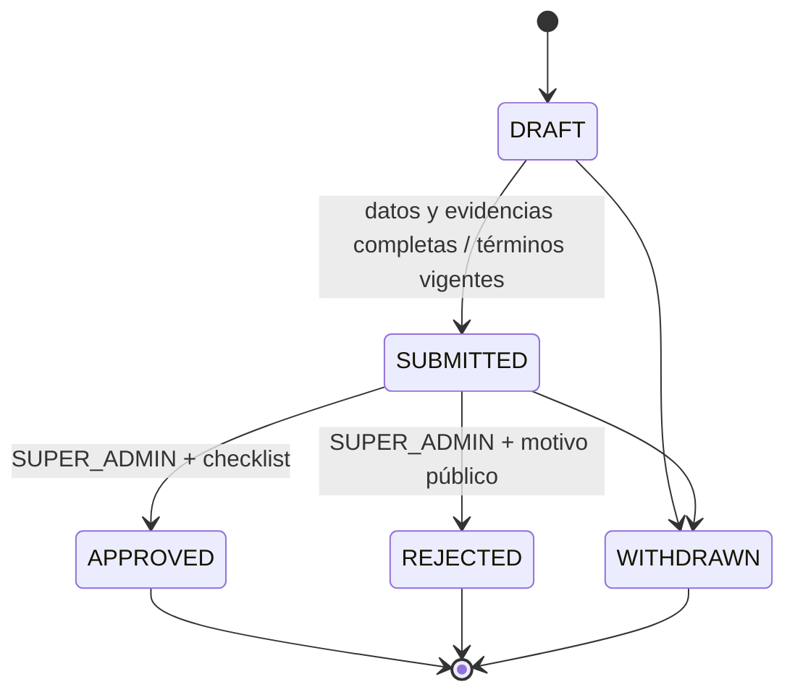

# Verificación documental — contrato implementado para pruebas locales

Fecha: 2026-10-13. Rama `feature/driver-verification`, HEAD `90b7243`, base main `1fa2cb1`. Sin integrar QA. Este documento sustituye las rutas **candidatas** de los diseños únicamente donde describe implementación existente. No es autorización de publicación ni de operación real.

## Alcance y separación de estados

Hay registro independiente sin proveedor, verificación de correo de cuentas existentes, términos personales/representativos de prueba, expedientes por recurso y ámbito, archivos privados, revisión SUPER_ADMIN, recuperación de comandos y notificaciones durables. La revisión documental no sustituye estados operativos, créditos, cobertura o autorización de un servicio.



Una corrección crea otro case tras retiro/rechazo; no reescribe lo revisado. Una renovación abierta no elimina la aprobación anterior todavía válida. Material operativo distinto del snapshot exige nueva revisión al asignar. Identidad y unidad tienen expedientes distintos. Una persona dual tiene subjects separados de flotilla e independiente: no se transfieren documentos entre ámbitos. `subjectId` del POST es el UUID del recurso; el `subjectId` persistido en la respuesta del case es el UUID del subject documental. `resourceId` permite diferenciarlos.

Independiente nuevo: confirma correo → User DRIVER autenticable → Driver PENDING/OFFLINE con providerId null + IndependentDriverProfile PENDING, atómicamente. Aprobar su identidad sólo habilita los estados iniciales PENDING; no rehabilita SUSPENDED/REJECTED. Unidad nueva por onboarding: INACTIVE con marcador de alta; la aprobación la activa sólo si sigue en ese estado inicial. Cualquier escritura administrativa explícita de `status` borra el marcador, incluso INACTIVE→INACTIVE; no se levanta una restricción anterior.

La licencia pertenece a identidad. SUPER_ADMIN revisa emisor/categoría, titular y tipos concretos declarados. No existe equivalencia jurídica automática emisor→categoría. MOTORCYCLE/CAR/PICKUP/VAN/TRUCK requieren licencia vigente cuyo array incluya el tipo exacto al asignar. BICYCLE queda fuera de esa regla; OTHER bloquea hasta clasificación. Vencimientos son instantes UTC, sin gracia; no se deducen licencias perpetuas ni fechas a partir de imágenes. Los catálogos oficiales/criterios definitivos siguen pendientes para producción.

## Activación exclusivamente local

- `DRIVER_VERIFICATION_LOCAL_ENABLED=false` por defecto. Con `NODE_ENV=production` todas las superficies nuevas fallan con 503 `VERIFICATION_LOCAL_DISABLED` incluso si se establece true.
- La fila singleton `VerificationPolicy` nace con `enabled=false`, `environment=LOCAL_TEST`. `POST /admin/verification-policy` es SUPER_ADMIN, sólo local, idempotente, exige expectedVersion. No se activó en ningún entorno existente.
- La fila de política se bloquea SHARE al admitir recursos hasta commit; activación usa UPDATE y espera esas transacciones. Una operación queda antes o después del corte, sin backfill de aprobación ni gracia. No modifica claim del proveedor ni búsqueda/matching.
- SQL exige además el contexto transaccional LOCAL_TEST para usar estos expedientes. El código lo establece únicamente con NODE_ENV development/test. Un escritor de producción o anterior que no lo establece no convierte recibos de prueba en habilitación. Drivers nuevos sin proveedor están sujetos a revisión incluso con política desactivada; los recursos legacy conservan su comportamiento previo mientras esté desactivada.
- `DriverVehicleAssignment` y `DeliveryAssignment` tienen barreras INSERT. No se exige nueva revisión al finalizar/liberar una asignación existente. Reasignación valida destino antes de terminar la anterior y publica ambos cambios atómicamente.
- Despliegue mixto no autorizado: actualizar todas las instancias/consumidores antes de considerar nullable y revisión. Volver al backend antiguo tras crear Drivers sin proveedor no es un rollback compatible. Este trabajo no habilita rollout ni fija configuración de producción.

## Términos, privacidad y representación

Las versiones `DRIVER-LOCAL-TEST-1` y `FLEET-LOCAL-TEST-1` contienen los borradores completos con encabezado inequívoco de **prueba local, sin vigencia contractual, sin autorización para datos reales**. Texto, hash y aceptaciones son inmutables en DB; servidor fija fecha, actor y método WEB_CHECKBOX_BUTTON. Los recibos indican `contractuallyEffective:false`.

Conductor acepta personalmente; PROVIDER_ADMIN acepta por proveedor con membership vigente y correo verificado. No puede aceptar por el conductor. La versión/hash enviada debe coincidir con la requerida bajo lock de política. Una versión nueva requiere presentación y aceptación expresa; replay de un intento ya aplicado recupera su recibo histórico y no acepta la nueva versión. Se relee autoridad antes del replay.

La invitación mínima de flotilla existente permanece disponible. Antes de crear/editar/subir/enviar su expediente personal se exige la aceptación del conductor y la de un representante vigente. La evidencia jurídica de facultades definitivas, aviso de privacidad y consentimientos específicos **no están inventados ni resueltos por membership o por estos términos de prueba**. Son bloqueos de uso real.

Para cuentas existentes con emailVerifiedAt null: solicitud autenticada de código y confirmación ligada a ese mismo usuario/email, sin modificar rol, contraseña ni Driver. El token no sirve como registro independiente ni como cambio de credenciales.

## API implementada

Prefijo `/api/v1`. HTTP humano Bearer, nunca IntegrationClient. UUID válido en parámetros; whitelist rechaza campos extra. Cache-Control no-store. Rol incorrecto 403, recurso ajeno/inexistente 404. Sólo JPEG/PNG; no se ofrece PDF como formato aceptado.

| Método/ruta | Actor | Resultado |
|---|---|---|
| POST `/independent-driver-registrations` y `/resend` | Público; email | 202 CHECK_EMAIL genérico; cooldown por correo y throttling |
| POST `/independent-driver-registrations/confirm` | token, password (política compartida 16–128), name | 200 CONFIRMED_LOGIN_REQUIRED; token consumido no sustituye contraseña ni emite sesión |
| POST `/verification-email/request` | DRIVER/PROVIDER_ADMIN autenticado | 202 CHECK_EMAIL |
| POST `/verification-email/confirm` | mismo actor, token | 200 EMAIL_VERIFIED |
| GET `/verification-requirements` | humano autorizado | formatos, límites, categorías y checklist LOCAL-TEST-1 |
| GET `/verification-terms?scope=DRIVER` o `scope=FLEET&providerId=UUID` | firmante del ámbito | texto/hash/version/environment |
| POST `/verification-terms/accept` | firmante | 200 recibo de prueba |
| GET `/verification-terms/acceptances/:id` | firmante con autoridad vigente | recibo y texto aceptado |
| GET `/driver/onboarding` | DRIVER, incluso PENDING | recursos, casos, aceptación y estado; no presupone proveedor |
| POST `/driver/onboarding/vehicles` | DRIVER con perfil independiente, incluso PENDING | 201 unidad INACTIVE; DTO de Vehicle existente sin `status`, cupo existente |
| POST `/driver/verification-cases` | independiente propietario | 201 borrador; en dual crea ámbito independiente |
| POST `/provider/verification-cases` | PROVIDER_ADMIN del recurso | 201 borrador del ámbito de flotilla |
| GET `/driver/verification-cases` | DRIVER propietario | página |
| GET `/provider/verification-cases?providerId=UUID` | miembro actual | página |
| GET `/admin/verification-cases` | SUPER_ADMIN | página; status y providerId opcionales |
| GET/PATCH `/verification-cases/:id` | lectura autorizada / presentador | detalle redactado / recibo con nueva revisión |
| POST `/verification-cases/:id/uploads` | presentador; expectedVersion, category | 201 uploadId (`id`), expiresAt, URL PUT privada y revisión |
| POST `/verification-cases/:id/uploads/:uploadId/complete` | presentador; expectedVersion | 200 VALIDATED; hashes/tamaño/tipo calculados por servidor |
| GET `/verification-cases/:id/attachments` | lectura autorizada | metadatos, nunca objectKey |
| POST `/verification-cases/:id/attachments/:attachmentId/access` | lectura autorizada | **200 binario image/png por proxy autenticado**, no URL GET pública |
| DELETE `/verification-cases/:id/attachments/:attachmentId` | presentador de DRAFT; expectedVersion | referencia REMOVED, no promesa de purga de cuenta |
| POST `/verification-cases/:id/submit` o `/withdraw` | presentador; expectedVersion | 200 recibo |
| POST `/admin/verification-cases/:id/decision` | SUPER_ADMIN | APPROVE/REJECT, expectedVersion, checklistVersion y passedChecks; rechazo exige publicReason |
| GET `/driver/verification-notifications` o `/provider/verification-notifications` | destinatario autorizado actualmente | últimos 100 avisos propios, sin notas internas |
| GET `/verification-command-attempts/:key?operation=…&target=…` | actor y ámbito originales | ABSENT/APPLIED/CLOSED_NO_EFFECTS |
| POST `/verification-command-attempts/:key/close` | actor original; operation/target | recibo existente o tombstone CLOSED_NO_EFFECTS |
| POST `/admin/verification-policy` | SUPER_ADMIN local | política durable actualizada |

GET de listas usa page/pageSize y orden createdAt,id; máximo100. `GET /driver/me` y disponibilidad conservan provider:null explícito y añaden estado documental sin archivos cuando aplica. `canTakeServices` es orientación general de identidad/perfil/ocupación; no garantiza vehículo, licencia, crédito u oferta concreta.

Idempotency-Key UUID obligatorio en mutaciones de términos/cases/unidades/uploads/decisión/política. El identificador de `access` no es un comando de negocio idempotente. Registro usa desafíos consumibles, no el namespace de comandos humanos.

| operation de recuperación | target |
|---|---|
| ACCEPT_TERMS | DRIVER o `FLEET:providerId` |
| CREATE_CASE | UUID del recurso Driver/Vehicle |
| CREATE_VEHICLE | SELF |
| UPDATE_CASE, CREATE_UPLOAD, COMPLETE_UPLOAD, REMOVE_ATTACHMENT, SUBMIT, WITHDRAW, DECIDE | UUID del case |
| POLICY | POLICY |

ABSENT no demuestra que una petición en vuelo falló. Close serializa con el comando mediante el mismo bloqueo por actor/clave y puede crear tombstone antes de la llegada tardía. No revierte un éxito. Misma clave/cuerpo devuelve recibo sin repetir decisión/unidad/outbox; distinto cuerpo o target produce IDEMPOTENCY_KEY_REUSED. El recibo no sustituye GET del estado vigente.

Errores implementados relevantes: VALIDATION_ERROR (400 de DTO), VERIFICATION_DATA_INVALID/IDEMPOTENCY_KEY_REQUIRED/REGISTRATION_INVALID (400); VERIFICATION_EMAIL_REQUIRED/VERIFICATION_FORBIDDEN (403); VERIFICATION_NOT_FOUND (404); VERIFICATION_VERSION_CONFLICT, VERIFICATION_OPEN_CASE_EXISTS, VERIFICATION_CASE_NOT_DRAFT, VERIFICATION_CASE_NOT_SUBMITTED, VERIFICATION_DOCUMENTS_PENDING, VERIFICATION_CHECKLIST_REQUIRED, VERIFICATION_MATERIAL_CHANGED, TERMS_ACCEPTANCE_REQUIRED, TERMS_VERSION_CONFLICT, IDEMPOTENCY_KEY_REUSED, VERIFICATION_ATTEMPT_CLOSED, VERIFICATION_REVIEW_REQUIRED, VERIFICATION_REVALIDATION_REQUIRED, VERIFICATION_EXPIRED, LICENSE_REQUIRED, LICENSE_EXPIRED, LICENSE_CATEGORY_MISMATCH, VERIFICATION_VEHICLE_CLASSIFICATION_REQUIRED (409); VERIFICATION_FILE_SIZE (413), VERIFICATION_FILE_TYPE/VERIFICATION_FILE_INVALID (415), throttling (429), STORAGE_UNAVAILABLE/VERIFICATION_LOCAL_DISABLED (503). Envelope normal statusCode/code/requestId/message/errors/timestamp/path.

## Ejemplos de cuerpos aceptados por código y pruebas sintéticas

Aceptar términos utiliza **version/hash que devuelve GET**, sin inventar un hash fijo:

```json
{"scope":"DRIVER","version":"DRIVER-LOCAL-TEST-1","hash":"<hash SHA-256 recibido en GET>","accepted":true,"method":"WEB_CHECKBOX_BUTTON"}
```

PATCH de identidad, con la revisión actual recibida:

```json
{"expectedVersion":1,"data":{"fullName":"Persona Sintética","contactPhone":"0000000000","operatingCity":"Ciudad sintética","documentType":"INE","license":{"issuer":"Emisor sintético","category":"Categoría revisada manualmente","expiresAt":"2027-10-13T12:00:00Z","vehicleTypes":["MOTORCYCLE"]}}}
```

PATCH de unidad prestada:

```json
{"expectedVersion":1,"data":{"declaredOwnerName":"Titular Sintético","ownershipEvidenceType":"BORROWED","serialNumber":"SYNTHETIC-001","authorizationExpiresAt":"2027-10-13T12:00:00Z"}}
```

Adjuntos: identidad FACE_PHOTO, INE_FRONT, INE_BACK y LICENSE si se declara licencia. Unidad REGISTRATION_CARD y OWNERSHIP_PROOF / RENTAL_CONTRACT / OWNER_AUTHORIZATION según modalidad. Se requiere circulación en este contrato de prueba también para BICYCLE: catálogo/excepciones definitivos deben cerrarse antes de publicar, no se declara obligación legal.

Decisión de identidad con licencia:

```json
{"expectedVersion":11,"decision":"APPROVE","checklistVersion":"LOCAL-TEST-1","passedChecks":["IDENTITY_MATCH","LEGIBLE","LICENSE_HOLDER","LICENSE_VALIDITY","LICENSE_CATEGORY"]}
```

`expectedVersion:11` es ilustrativo; cliente debe consultar la revisión real. Toda carga/edición/completado incrementa revisión. Unidad exige UNIT_MATCH, LEGIBLE, AUTHORIZED_USE. La respuesta de decisión tiene id, status APPROVED/REJECTED, revision y decidedAt; no acredita dinero, entrega ni pago alguno.

## Archivos y correo

Adaptador `SpacesVerificationStorage` con SDK S3, endpoint HTTPS regional explícito, credenciales explícitas por composición, ACL private, sin crear/listar buckets y sin CDN. Binding deshabilitado si falta configuración. Variables nuevas opcionales `VERIFICATION_SPACES_ENDPOINT`, `VERIFICATION_SPACES_BUCKET`, `VERIFICATION_SPACES_ACCESS_KEY`, `VERIFICATION_SPACES_SECRET_KEY`; no se escribió .env ni se proporcionaron valores reales.

Servidor genera keys opacas por ámbito/recurso/case/attachment; el cliente no elige key, bucket, actor ni dueño. URL PUT de cuarentena dura hasta300s; el completado verifica autorización, revisión y vigencia, lee como máximo10MiB, decodifica máximo20MP y normaliza a PNG sin metadatos. Máximo10 intentos de archivo por case, incluidos retirados; usar nuevo case si se agota. VALIDATED significa validación de formato/decodificación, **no CLEAN ni antimalware**. Se conserva hash fuente y hash de la imagen normalizada que realmente se revisa. El original de cuarentena no se presenta a revisores. Archivo normalizado se entrega por proxy con autorización nueva y hash verificado; no se persiste una URL firmada de lectura.

No hay evidencia real de Spaces ni de análisis antimalware. La configuración de bucket/versionado/CORS/límites de carga y limpieza de temporales sigue pendiente. Una URL PUT emitida conserva su vigencia corta aunque cambie el permiso; no permite completar ni leer tras perder autorización. No prometer revocación instantánea de esa credencial ni borrado de backups.

Decisión, evento y outbox por destinatario se guardan en una transacción. Correo de decisión usa Resend existente, sin documentos/motivos privados, con clave por aviso, leases, fencing por número de intento y hasta5 intentos de **correo** (no son los cinco intentos de búsqueda). Estado ACCEPTED_BY_PROVIDER no demuestra entrega al buzón. Errores inciertos quedan consultables; nunca revierten decisión. Se verifica destinatario/ámbito antes de enviar; no se promete exactly-once externo. El registro puede reenviar un desafío tras cooldown si falla correo; no se declara que el email se entregó.

## Locks, integridad y límites

Comandos humanos: advisory por actor/clave → autoridad/membership vigente → proveedor cuando aplica → recurso Driver o Vehicle → subject/case → política SHARE para requisitos. CREATE_CASE serializa creación del subject bajo recurso; índices parciales impiden dos abiertos. Aceptación usa política SHARE y bloqueo por firmante/version/ámbito; close no espera recursos. Admisión conserva orden operativo despacho→proveedor→driver/perfil→vehicle; verificación adquiere recursos ya bloqueados y política SHARE. Activación sólo modifica política, no toma recursos después. Decisión no adquiere despacho. PostgreSQL conserva FKs/owners existentes, exige perfil al commit para Driver sin proveedor y evita borrar ese perfil dejando huérfano.

Términos, aceptaciones, comandos y eventos no se reescriben ni borran por API; cases terminales y archivos enviados quedan congelados. El estado documental efectivo se compara con snapshot material y vigencias al asignar. Un rol con privilegios de administración de PostgreSQL puede cambiar funciones o esquema; no se afirma protección frente a un superusuario de DB.

Existe transacción acotada hasta30s en comandos; completado de imagen hace lectura/escritura del adaptador bajo lock del case. Es una limitación local deliberada para evitar publicar generaciones cambiadas; escáner asíncrono con leases y presupuestos de producción no está implementado. No atribuir a este prototipo capacidad operativa de cargas reales a escala.

## Pendientes que bloquean producción y baja completa

No se publica endpoint de cierre de cuenta ni se promete purga implementada. Las decisiones pendientes afectan directamente qué filas/objetos se pueden borrar y qué recibos se conservan:

1. **Titular de cada archivo compartido:** opción recomendada a evaluar: baja personal elimina identidad del conductor y desvincula accesos, sin borrar unidades de la flotilla; unidad compartida requiere procedimiento propio de separación/supresión de datos de terceros. Alternativa: copia documental separada por finalidad, con coste y duplicación; no adoptada. Borrar un administrador nunca borra expedientes de toda la flota.
2. **Servicio activo y sesión después de baja:** definir reautenticación, coordinación segura y recibo de seguimiento de alcance mínimo. No cancelar servicios ni bloquear indefinidamente la solicitud de privacidad por defecto.
3. **Recibos/auditoría:** plazo y minimización aprobados, obligaciones concretas; no retención indefinida inferida. Las barreras de inmutabilidad necesitarán una vía explícita de purga autorizada, no eliminar triggers a mano.
4. **Backups/versionado/temporales:** plazo verificable, inventario por versiones, propagación de tombstones en restauración y verificación de borrado. El adaptador remove de un objeto no acredita eliminación de versiones ni respaldos.
5. Textos definitivos, operador/contactos, privacidad/consentimientos separados, representación, catálogo/vigencias oficiales y criterios de revisión; ningún recibo local se migrará a contractual efectivo.
6. Spaces real, IAM privado, región, cuotas, presupuesto, formato PDF si se requiere, antimalware, observabilidad, gestión de fallos y pruebas Web/App. No apto todavía para producción.

Se conserva la política del propietario de mantener archivos mientras exista la cuenta y eliminarlos a solicitud de baja. Precisamente por falta de un procedimiento completo de supresión no se habilita captura de datos reales ni producción. No hay excepción indefinida aprobada.

## Handoff Web y App

**Web:** usar main compatible, sin importar QA. Provider nullable en DriverSelf y referencia independiente. Separar onboarding de guard operativo aprobado. Registro→confirmación→login; existentes con VERIFICATION_EMAIL_REQUIRED solicitan/confirmarán correo. Mostrar documento completo/version, casilla inicialmente desmarcada, botón explícito por ámbito. Respuesta conflictiva de versión exige nueva presentación y limpiar casilla. No suplir aceptación del conductor desde proveedor.

Crear borrador por recurso; consultar requirements, subir bytes a PUT privado y completar con revisión actual. No persistir archivos/URLs/tokens/PII en marcadores; guardar key/operation/target y recuperar por GET intento y GET case. Manejar 409 sin repetir con nueva clave automáticamente. Acceso devuelve PNG autenticado, no un string URL. Bandeja SUPER_ADMIN separa motivo público/nota interna; enviar checklist exacto y expectedVersion. Renovación y estados operativos distintos; no inferir activación ni crédito de un recibo. Presentar con claridad «PRUEBA LOCAL — SIN VIGENCIA CONTRACTUAL».

**App:** abrir Web por entorno, sin token en URL. Al volver consultar estado autenticado; no inferir aceptación por retorno. No descargar documentos en caché operativa/GPS ni iniciar ubicación por alta/aprobación. Conservar recuperación y ejecución ya autorizada ante corte/vencimiento. Incompatibilidad operativa Android/main previamente documentada sigue fuera de alcance; estos comandos documentales no sustituyen TAKE/RELEASE/DELIVER ni habilitan la app actual contra main.

No se modificó ningún repositorio de Web, App, Landing o Coita Eats.

## Validación e inventario de esta tarea

- **181/181 unitarias en8 archivos**, **128/128 E2E en6 archivos**, **33/33 checks públicos**. Archivos y casos únicos en [evidencia sanitizada](checks/driver-verification-evidence.json). Consolidado de ejecuciones de esta tarea; no una ejecución global simultánea. Archivos no afectados no se repitieron.
- Archivo nuevo documental24/24; unidades14/14 incluyendo SDK con transporte controlado. Asignaciones15/15 en el único diagnóstico threads. Los otros cuatro E2E completos acreditan B2B21, finalización29, búsqueda16 e independientes23.
- Intento previo de asignaciones dejó3 casos pendientes aunque su etiqueta de archivo decía passed; no se acredita. No hubo más diagnósticos de ese archivo. No se afirma causa nativa ni eliminación de intermitencia. Fallos ordinarios de desarrollo (tipos/fixtures/advisory void/UTC) se corrigieron; intentos fallidos no se suman.
- Migración20261013000100_driver_verification añade tablas, FKs, inmutabilidad y barreras; Driver.providerId nullable y marcador inicial de Vehicle. Limpia, upgrade desde32 con Driver previo idéntico, reaplicación y drift verificados en PostgreSQL18 temporal loopback55439.32 migraciones históricas sin diferencias respecto a HEAD.
- Build, tsconfig.build.json y tsconfig.json, ESLint de afectados, Oxlint, Prisma, docs:check y contrato público pasan. Oxlint mantiene una advertencia preexistente en verify-authorized-acceptance-c3-regression.mjs.
- [Respuestas HTTP reales con fixtures sintéticas](checks/driver-verification-http-examples.json): requirements, onboarding y case; sin Authorization, contraseñas ni URLs firmadas. No equivalen a prueba de Web/Android o infraestructura externa.

Archivos de producto añadidos: src/verification/{verification-error,verification-policy,verification-rules,verification-storage,verification.dto,verification.responses,verification.service,verification.controller,verification-notifications,verification.module}.ts y migración nueva. Integración: prisma/schema.prisma, app.module, config/environment, DriversService/DTO de self, respuestas independientes, AssignmentsService, DeliveryAssignmentsService, IndependentDispatchesService y MailProvider/Resend/local outbox. Dependencias @aws-sdk/client-s3, @aws-sdk/s3-request-presigner y sharp; package1.12.0 conservado.

Pruebas nuevas driver-verification.spec.ts y driver-verification.e2e-spec.ts; ampliado delivery-assignments.e2e-spec.ts. Mocks/tipos ajustados en logistics, independent-drivers, delivery-assignments, invitations y partner-applications sin debilitar aserciones. Verificador nuevo scripts/verify-driver-verification-migrations.mjs. OpenAPI/API_ACCESS y documentación actualizados preservando cambios ajenos e historial.

Referencias técnicas del adaptador: [Spaces con SDK S3](https://docs.digitalocean.com/products/spaces/reference/aws-sdks/) y [límites de decodificación sharp](https://sharp.pixelplumbing.com/api-constructor/). Estas referencias no acreditan una integración real.

Cierre final: añadido guard BEFORE DELETE de adjuntos para impedir borrar directamente la evidencia congelada. Comprobación SQL aislada PASS con fila preservada; upgrade/reaplicación/drift repetidos sobre la migración definitiva PASS. El clúster PostgreSQL temporal quedó detenido, conservando sólo fixtures sintéticas para inspección. No se alteró el conteo de casos de prueba.
